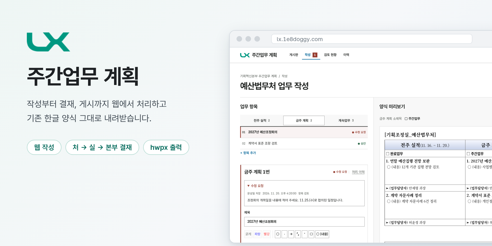
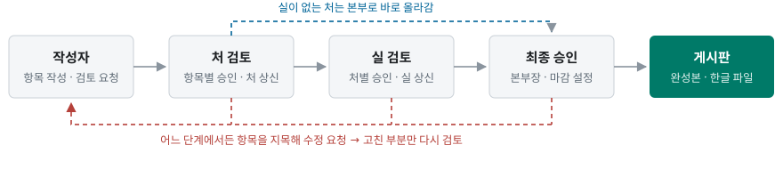
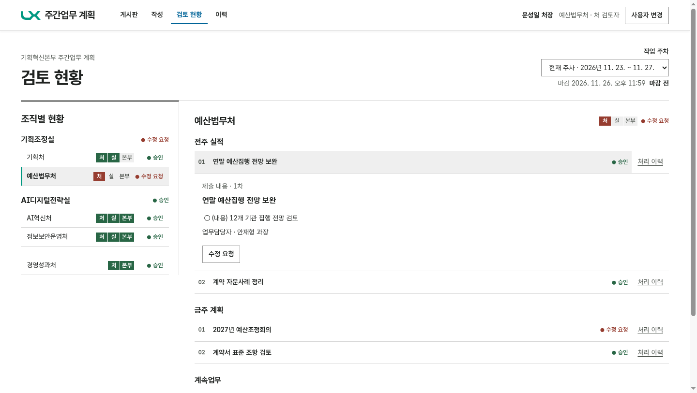
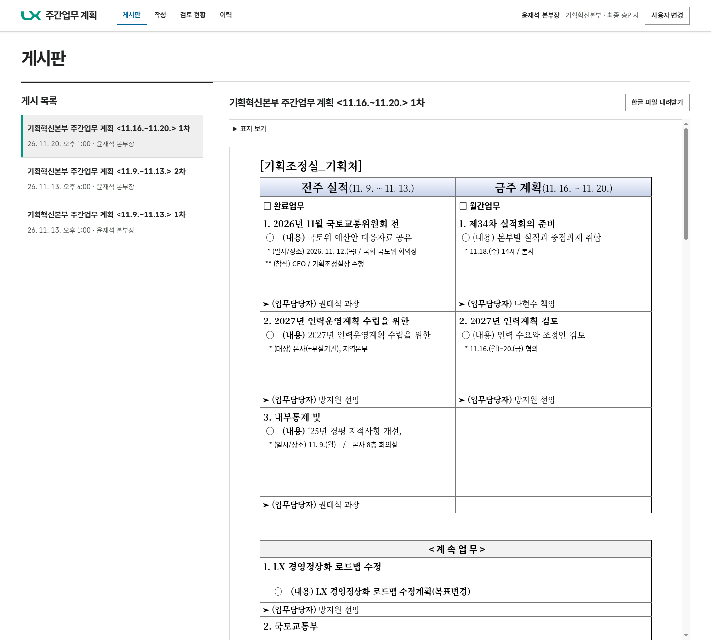
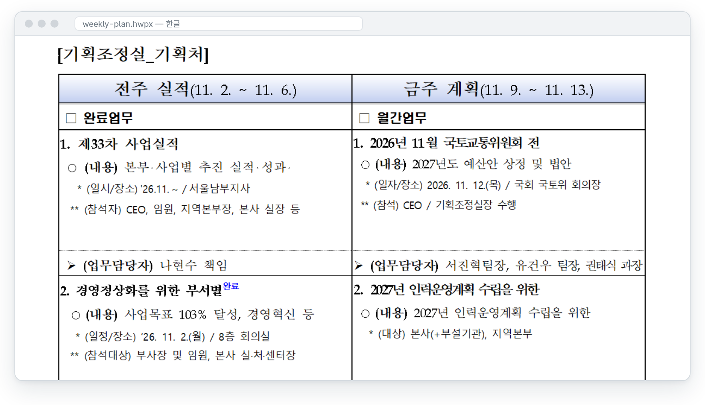

<p align="center">
  
</p>

<p align="center">
  <a href="https://lx.1e8doggy.com"></a>
  
  
  
  
  
</p>

<p align="center">
  <a href="#소개">소개</a> ·
  <a href="#결재-흐름">결재 흐름</a> ·
  <a href="#화면">화면</a> ·
  <a href="#만든-방식">만든 방식</a> ·
  <a href="#실행">실행</a>
</p>

<br>

## 소개

LX 기획혁신본부는 매주 처마다 한글 파일로 주간업무 계획을 써서 주고받고, 단계마다 검토를 거쳐 손으로 모읍니다.
이 시스템은 그 과정을 웹 페이지 하나로 옮기고, 결과물은 원래 쓰던 한글 양식 그대로 내려받게 합니다.

<table>
  <tr>
    <td width="33%" valign="top">
      <b>웹에서 작성</b><br><br>
      항목을 칸별로 입력하면 옆의 양식 미리보기에 바로 반영됩니다.
    </td>
    <td width="33%" valign="top">
      <b>단계별 결재</b><br><br>
      처 → 실 → 본부 순서로 승인하고, 어느 단계에서든 항목을 지목해 수정을 요청합니다.
    </td>
    <td width="33%" valign="top">
      <b>한글 양식 그대로</b><br><br>
      게시된 완성본을 원본 양식과 같은 hwpx 파일로 내려받습니다.
    </td>
  </tr>
</table>

## 결재 흐름

<p align="center"></p>

- 처 검토자는 항목별로 승인하고, 처의 모든 항목이 승인되면 처 취합본을 올립니다. 실이 없는 처는 본부로 바로 올라갑니다.
- 어느 단계에서든 항목을 지목해 수정을 요청할 수 있고, 고쳐 올리면 위 단계는 고친 부분만 다시 봅니다.
- 마감은 최종 승인자가 정하고, 다음 주차는 지난주 "금주 계획"을 "전주 실적"으로 넘겨 시작합니다.

## 화면

<table>
  <tr>
    <td width="50%" valign="top">
      
      <p><b>검토 현황</b><br><sub>조직별 진행 상태를 한눈에 보고, 항목을 펼쳐 승인하거나 수정을 요청합니다.</sub></p>
    </td>
    <td width="50%" valign="top">
      
      <p><b>이력</b><br><sub>누가 언제 검토를 요청하고 승인했는지, 그때 제출한 내용이 무엇이었는지 남습니다.</sub></p>
    </td>
  </tr>
  <tr>
    <td width="50%" valign="top">
      
      <p><b>게시판</b><br><sub>최종 승인된 계획을 차수별로 모아 보고 한글 파일로 내려받습니다.</sub></p>
    </td>
    <td width="50%" valign="top">
      
      <p><b>내려받은 한글 파일</b><br><sub>원본 양식의 표, 서식, 수식 필드가 그대로 유지됩니다. 한글에서 연 화면입니다.</sub></p>
    </td>
  </tr>
</table>

**작성 화면에서 할 수 있는 일**

| 입력 | 표 | 협업 |
|---|---|---|
| 굵게, 파랑·빨강 강조<br>자주 쓰는 특수 문자 버튼<br>Ctrl+Z 되돌리기·다시 하기 | 행·열 추가, 병합, 합계 수식<br>머리 색·회색 칠하기<br>앞 표 옆에 나란히 붙이기 | 한 항목에 여러 담당자<br>편집 중에는 다른 사람은 읽기만<br>받은 수정 요청을 항목 아래에 표시 |

## 만든 방식

> **양식은 새로 그리지 않습니다.**
> 원본 hwpx를 틀로 두고, 그 안의 XML에서 내용이 들어갈 자리만 바꿔 다시 묶습니다. 표지, 로고, 표 테두리, 글꼴이 그대로 남습니다.

> **새로 추가한 표도 원본 규칙을 따릅니다.**
> 칸 여백, 행 높이, 테두리, 문장과 표 사이 간격을 원본 파일의 값에 맞췄고, 실제 한글에서 열어 쪽별로 비교했습니다.

> **미리보기와 출력이 같은 데이터에서 나옵니다.**
> 화면의 양식 미리보기와 hwpx 출력이 같은 구조를 읽어, 보이는 것과 받는 것이 어긋나지 않습니다.

> **조직과 결재 단계는 데이터입니다.**
> 본부·실·처 구성과 검토 순서를 코드에 고정하지 않았습니다.

## 실행

```bash
bun install
bun run demo      # 예제 조직·사용자·업무 데이터 생성
bun run dev       # http://127.0.0.1:4310
```

<details>
<summary><b>명령과 설정</b></summary>

<br>

| 명령 | 하는 일 |
|---|---|
| `bun test` | 테스트 실행 |
| `bun run typecheck` | 타입 검사 |
| `bun run export` | 예제 데이터를 `out/weekly-plan.hwpx`로 출력 |
| `bun run reset` | 데이터 초기화 |

| 환경 변수 | 기본값 |
|---|---|
| `PORT` | `4310` |
| `HOST` | `127.0.0.1` |
| `DATABASE_PATH` | `data/weekly-plan.sqlite` |

</details>

<details>
<summary><b>기술 구성과 폴더</b></summary>

<br>

| 구분 | 사용 |
|---|---|
| 런타임·서버 | Bun (`Bun.serve`) |
| 화면 | React 19 |
| 저장 | SQLite (`bun:sqlite`) |
| hwpx 생성 | fflate (zip), 자체 XML 처리 |
| 글꼴 | Pretendard GOV |

```
assets/template/   원본 주간업무 계획 hwpx (출력용 틀)
src/server/        API, 결재 흐름, hwpx 생성
src/shared/        화면과 서버가 함께 쓰는 데이터 구조
src/ui/            화면
scripts/           예제 데이터 생성, 검증 스크립트
```

</details>

<br>

<p align="center"><sub>화면과 파일에 나오는 사람 이름과 업무 내용은 모두 가상입니다.</sub></p>
