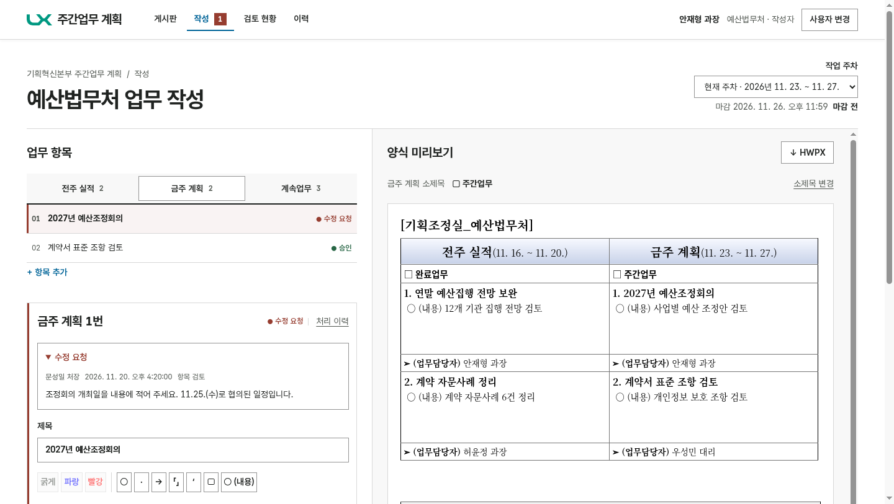
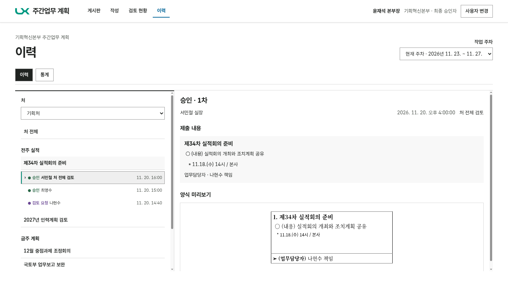
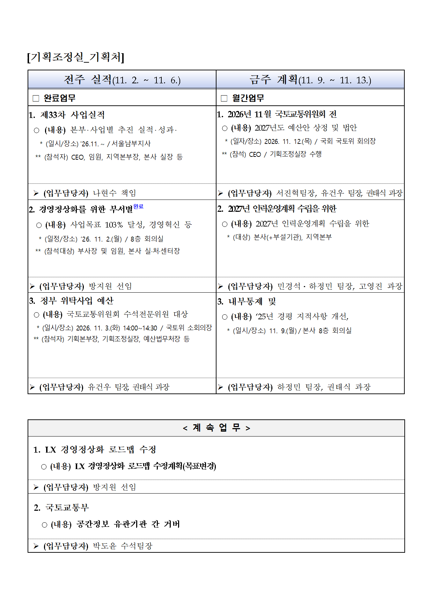

<div align="center">


# 주간업무 계획

**LX 기획혁신본부의 주간업무 계획을 웹에서 작성·검토·게시하고,<br>기존 한글 양식 그대로 hwpx 파일로 내려받는 시스템**

<a href="https://lx.1e8doggy.com">lx.1e8doggy.com</a>

</div>

<br>



처마다 한글 파일을 따로 써서 주고받고 손으로 모으던 일을, 웹 페이지 하나에서 끝냅니다.

## 핵심

| 웹에서 작성 | 단계별 결재 | 한글 양식 그대로 |
|---|---|---|
| 항목을 칸별로 입력하면 옆의 양식 미리보기에 바로 반영됩니다. | 처 → 실 → 본부 순서로 승인하고, 어느 단계에서든 항목을 지목해 수정을 요청합니다. | 게시된 완성본을 기존 양식과 같은 hwpx 파일로 내려받습니다. |

## 결재 흐름

<p align="center"></p>

- 처 검토자는 처의 모든 항목이 승인되면 처 취합본을 올립니다.
- 승인된 항목을 고쳐 다시 올리면 위 단계는 고친 부분만 다시 봅니다.
- 마감은 최종 승인자가 정하고, 다음 주차는 지난주 "금주 계획"을 "전주 실적"으로 넘겨 시작합니다.

## 화면

### 작성
제목, 내용, 참고 사항, 표, 담당자를 칸별로 입력합니다. 받은 수정 요청은 해당 항목 바로 아래에 보입니다.

- 굵게와 파랑·빨강 강조, 자주 쓰는 특수 문자 버튼
- 표 편집: 행·열 추가, 병합, 합계 수식, 셀 색, 앞 표 옆에 붙이기
- Ctrl+Z 되돌리기와 다시 하기, 임시 저장
- 한 사람이 편집하는 동안 다른 담당자는 읽기만 하도록 잠금

### 검토 현황
조직별 진행 상태를 한눈에 보고, 항목을 펼쳐 승인하거나 수정을 요청합니다.


### 게시판
최종 승인된 주간업무 계획을 차수별로 모아 보고 한글 파일로 내려받습니다.


### 이력
항목마다 누가 언제 검토를 요청하고 승인했는지, 그때 제출한 내용이 무엇이었는지 남습니다.



### 내려받은 한글 파일
웹에서 쓴 내용이 원본 양식의 표, 서식, 수식 필드를 그대로 유지한 채 들어갑니다. 아래는 한글에서 연 화면입니다.

<p align="center"></p>

## 만든 방식

- **양식은 새로 그리지 않습니다.** 원본 hwpx를 틀로 두고, 그 안의 XML에서 내용이 들어갈 자리만 바꿔 다시 묶습니다. 그래서 표지, 로고, 표 테두리, 글꼴 같은 양식 요소가 그대로 남습니다.
- **새로 추가한 표도 원본 규칙을 따릅니다.** 칸 여백, 행 높이, 테두리, 문장과 표 사이 간격을 원본 파일의 값에 맞췄고, 실제 한글에서 열어 쪽별로 비교했습니다.
- **미리보기와 출력이 같은 데이터에서 나옵니다.** 화면의 양식 미리보기와 hwpx 출력이 같은 구조를 읽기 때문에 보이는 것과 받는 것이 어긋나지 않습니다.
- **조직과 결재 단계는 데이터입니다.** 본부·실·처 구성과 검토 순서는 코드에 고정하지 않았습니다.

## 기술

| 구분 | 사용 |
|---|---|
| 런타임·서버 | [Bun](https://bun.sh) (`Bun.serve`) |
| 화면 | React 19 |
| 저장 | SQLite (`bun:sqlite`) |
| hwpx 생성 | fflate (zip), 자체 XML 처리 |
| 글꼴 | Pretendard GOV |

## 실행

```bash
bun install
bun run demo      # 예제 조직·사용자·업무 데이터 생성
bun run dev       # http://127.0.0.1:4310
```

| 명령 | 하는 일 |
|---|---|
| `bun test` | 테스트 실행 |
| `bun run typecheck` | 타입 검사 |
| `bun run export` | 예제 데이터를 `out/weekly-plan.hwpx`로 출력 |
| `bun run reset` | 데이터 초기화 |

환경 변수 `PORT`, `HOST`, `DATABASE_PATH`(기본 `data/weekly-plan.sqlite`)로 주소와 저장 위치를 바꿀 수 있습니다.

## 폴더

```
assets/template/   원본 주간업무 계획 hwpx (출력용 틀)
src/server/        API, 결재 흐름, hwpx 생성
src/shared/        화면과 서버가 함께 쓰는 데이터 구조
src/ui/            화면
scripts/           예제 데이터 생성, 검증 스크립트
```

<sub>화면과 파일에 나오는 사람 이름과 업무 내용은 모두 가상입니다.</sub>
